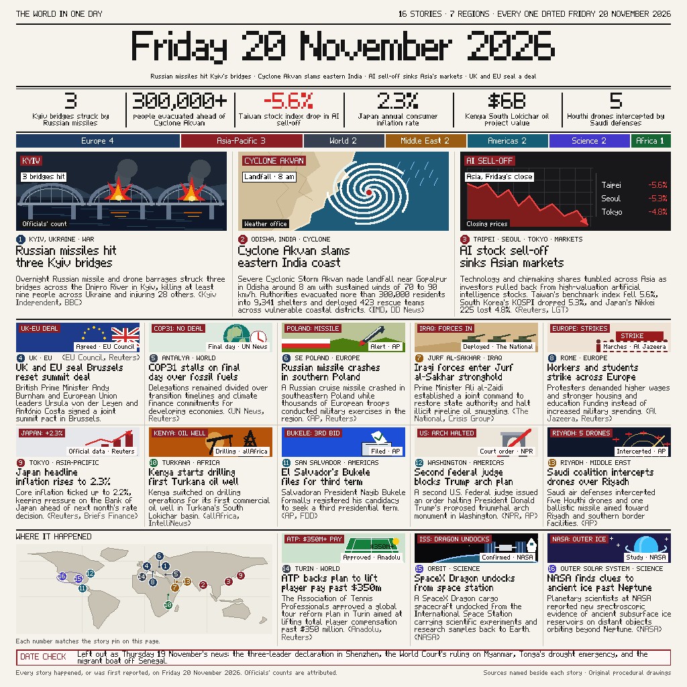

# news-image-20261120

[](https://make.fun/bounty/news-image-20261120?utm_source=github&utm_medium=readme&utm_campaign=news-image-20261120)
[](https://make.fun/bounty/news-image-20261120/leaderboard?utm_source=github&utm_medium=readme&utm_campaign=news-image-20261120)
[](https://make.fun/bounty/news-image-20261120?utm_source=github&utm_medium=readme&utm_campaign=news-image-20261120)

## Final image — Friday 20 November 2026



Original procedural newspaper drawing: 16 stories, six KPI values, seven
region colors, 16 numbered map pins, a date-exclusion box and a complete
footer. The font gate was approved before this full build began.

## Generate and verify

Tested with **Node.js v22.23.5**. No installation step or external package is
required. The generator uses only Node.js built-ins and this repository's
newly authored source files; it does not use network access, font files,
image atlases, base64 assets, randomness or clock-based image content.

```sh
node main.ts
node verify.ts
```

`main.ts` writes `/output/entry.png` (`C:\output\entry.png` on Windows), then
copies those exact bytes to `out/entry.png`, the image deliverable kept in
this repository.

`verify.ts` runs the generator twice **sequentially**, compares actual PNG
bytes and SHA-256 values, checks the output copy, validates the PNG, and
audits every headline, source, selected sentence, text bound and map pin.
Running `node verify.ts` generates both reports **locally**:
`out/render-report.json` contains the deterministic layout and content audit;
`out/verification-report.json` contains verification results and observed
runtimes. Both are runtime outputs, ignored by Git and **not stored in the
repository**. Run `node verify.ts` to recreate them when needed.

## Verified result

| Check | Result |
| --- | --- |
| Dimensions | 1024 × 1024 |
| PNG encoding | 8-bit RGB, color type 2, no alpha |
| Scanline filters | All 1024 rows use filter 0 |
| Chunks | IHDR, IDAT, IEND; every CRC verified independently |
| Size | 54,768 bytes; below 1 MiB |
| Run 1 | 416.57 ms generator; 605.06 ms including Node startup |
| Run 2 | 408.71 ms generator; 591.37 ms including Node startup |
| Determinism | Both PNG files and both render audits are byte-identical |
| Repository copy | Byte-identical to the primary output |
| Content | All 16 original headlines and all complete source attributions |
| Geometry | No text-box overlaps or text outside page/card bounds |
| Audited map pins | Pins 5, 6, 11, 12, 14, 15 and 16 lie on their drawn continent; minimum pin spacing 15 px |

Both final PNG runs have SHA-256:

```text
e0a3bbb76c7aba46bdaa7adb71d5c906102e0eca04bbc49a9ac051ff55c8c1de
```

During the original full build, the first render was opened for visual inspection. One subsequent
whole-file rewrite of `main.ts` balanced headline line breaks, removing the
single-word `coast` orphan without changing any title or font size. The final
PNG was regenerated twice and opened again for visual inspection.

## Design-audit correction round

One audit round was applied through **targeted patches only**, with no
whole-file rewrites, against baseline commit
`eb87a7590d01070b2e512dd8fda3d178ad5d34d7`.

- **Story #4 source attempt:** the exact first sentence followed by
  `(EU Council, Reuters)` was measured at 9 px / 11.5 px leading in its
  184 × 56 px summary box. It needs **six lines / 68 px**, exceeding the
  available height by 12 px. The source therefore **returned to the kicker**;
  the first sentence remains intact at five lines / 56 px. No font shrinking
  or internal sentence cuts were used. The local JSON reports generated by
  `node verify.ts` record the exact attempted text, wrapped lines,
  measurements and fallback outcome; these reports are not committed.
- **Map:** only badges 5, 6, 11, 12, 14, 15 and 16 were moved. Their centers
  and corresponding raster pixel centers are checked against the existing
  Eurasian or North American land polygon. All 16 true location anchors,
  all coastlines and the other nine badge positions are unchanged. The
  Europe cluster 1, 4, 6, 8 and 14 stays separated; the minimum center
  distance across the entire map is 15 px.
- **Illustrations:** the STRIKE banner and lettering moved up 5 px, with
  banner height reduced from 14 to 13 px; the `$350M+` label moved up 5 px.
  Story #12's sky and arch opening now use `#DCE4EE`. Story #6's projectile
  silhouette moved up 6 px.
- **DATE CHECK:** both black lines moved down 1 px, to y=971 and y=981.
  The 24 px box height, red label and all other zones are unchanged.
- **Preservation:** the approved typeface source and masthead raster are
  unchanged and hash-checked by `verify.ts`. A baseline pixel comparison
  found changes only inside the six audited image regions; all headlines,
  summary selections, locked data and ownership metadata remain unchanged.

The corrected image was opened for visual inspection. Final verification
passed for two sequential byte-identical PNG renders and locally generated render reports;
`C:\output\entry.png` and `out/entry.png` are byte-identical.

## Sentence-boundary fitting — every omission disclosed

`news-data.json` contains the complete locked content: both original
sentences, the original headline, full source attribution and exact pin
coordinates for every story. Nothing in that data is shortened.

In the rendered image, a complete two-sentence summary is used whenever it
fits its allocated box at **9 px cap height / 11.5 px leading**. Otherwise,
the first complete sentence is used if it fits; if not, the second complete
sentence is used. No sentence is paraphrased, reordered or cut internally.
Every story retains at least one intact sentence and its complete source.

| Pin | Original headline | Sentences shown | Sentence omitted |
| --- | --- | --- | --- |
| 1 | Russian missiles hit three Kyiv bridges | 1 | 2 |
| 2 | Cyclone Akvan slams eastern India coast | 1, 2 | None |
| 3 | AI stock sell-off sinks Asian markets | 1, 2 | None |
| 4 | UK and EU seal Brussels reset summit deal | 1 | 2 |
| 5 | COP31 stalls on final day over fossil fuels | 2 | 1 |
| 6 | Russian missile crashes in southern Poland | 1 | 2 |
| 7 | Iraqi forces enter Jurf al-Sakhar stronghold | 2 | 1 |
| 8 | Workers and students strike across Europe | 2 | 1 |
| 9 | Japan headline inflation rises to 2.3% | 2 | 1 |
| 10 | Kenya starts drilling first Turkana oil well | 1 | 2 |
| 11 | El Salvador's Bukele files for third term | 1 | 2 |
| 12 | Second federal judge blocks Trump arch plan | 1 | 2 |
| 13 | Saudi coalition intercepts drones over Riyadh | 1 | 2 |
| 14 | ATP backs plan to lift player pay past $350m | 1 | 2 |
| 15 | SpaceX Dragon undocks from space station | 1 | 2 |
| 16 | NASA finds clues to ancient ice past Neptune | 1 | 2 |

The **exact full text of every omitted sentence**, the retained sentences,
and measured line counts/heights are recorded per pin in the local runtime
reports `out/render-report.json` and `out/verification-report.json`.
Generate these reports with `node verify.ts`; they are not stored in the repo.

Story #4's full source is placed in its kicker row so its first sentence can
fit intact at 9 px. Some summary boxes fit five lines within their specified
pixel height. No summary font was shrunk to force a fit. Font measurement uses
actual rounded filled-cell edges, with at least one blank pixel between
characters; the approved glyph shapes are unchanged.

## Layout and original source

- `main.ts`: exact A–G zone placement, content checks and output handling.
- `typeface.ts`: the original approved proportional filled-cell alphabet.
- `raster.ts`: RGB drawing, PNG encoding and independent bitwise CRC checking.
- `illustrations.ts`: all 16 original geometric news illustrations.
- `world-map.ts`: hand-authored schematic coastlines and collision-free pins.
- `news-data.json`: the complete locked 16-story data and six KPI values.
- `verify.ts`: repeat-run, byte, PNG, content and layout verification.

The font-gate source is preserved as `font-gate.ts`; `node font-gate.ts`
regenerates `test-font.png`. Its historical approval commit is
`9870d02209ef0e3a9eb01c0c112d2a01c9a4e6c5`, with its original
`font-gate-report.json` retained as Stage 1 evidence.

`.makefun/owner.json` and the existing ownership/freshness metadata are
unchanged. No make.fun initialization, wallet, or submission commands were run.
