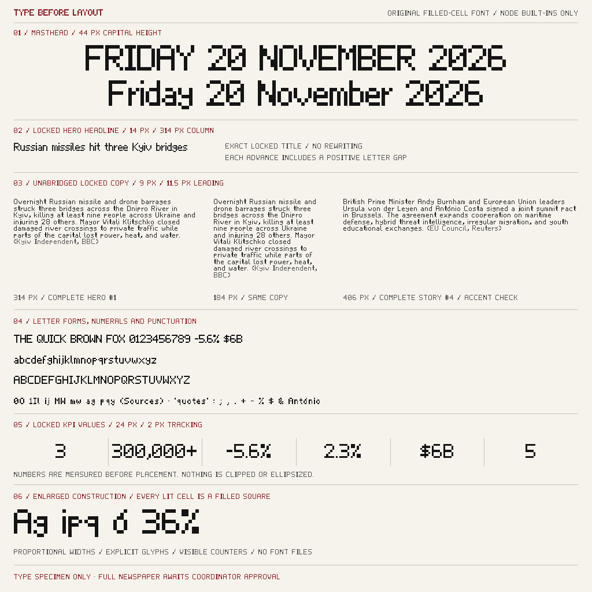

# news-image-20261120

[](https://make.fun/bounty/news-image-20261120?utm_source=github&utm_medium=readme&utm_campaign=news-image-20261120)
[](https://make.fun/bounty/news-image-20261120/leaderboard?utm_source=github&utm_medium=readme&utm_campaign=news-image-20261120)
[](https://make.fun/bounty/news-image-20261120?utm_source=github&utm_medium=readme&utm_campaign=news-image-20261120)

## Stage 1: font gate — awaiting coordinator approval

This is a type specimen, **not the completed news image**. The full newspaper
layout must not begin until the coordinator verifies this font gate on GitHub.
There is deliberately no final `entry.png` produced by this stage.



## Run

Requires Node.js 22.18 or newer; tested with Node.js 22.23.5. No installation,
packages, font files, image atlas, network access or nondeterministic input is
needed. Run directly from this repository:

```sh
node main.ts
```

The only generated file at this stage is `test-font.png` (1024 × 1024).
`main.ts` is self-contained and imports only Node.js built-ins. The font glyphs,
RGB rasterizer, text measurement, wrapping, PNG chunks and CRC32 code were
written anew for this build. Legacy renderer modules have been removed.

## What to inspect

- Uppercase `FRIDAY 20 NOVEMBER 2026` and mixed-case mastheads, 44 px cap height.
- The exact locked hero #1 headline at 14 px in a 314 px column.
- The complete locked hero #1 summary and attribution at 9 px, in both
  314 px and 184 px columns, without abbreviations or ellipses.
- The complete locked story #4 summary, including `António`, at 9 px.
- `THE QUICK BROWN FOX 0123456789 -5.6% $6B`, both alphabets, and punctuation.
- All six unchanged KPI values, 24 px cap height and 2 px tracking.
- Enlarged glyphs demonstrating solid, individually filled cells.

Every glyph has a measured proportional advance and a positive inter-letter
gap. Text is wrapped before rendering, and the wrapped lines must reconstruct
the input verbatim. Hard assertions check column bounds, page bounds, and
pairwise non-overlap of all text boxes. Sources use `#525252` separately from
body copy `#262626`.

## Technical checks

The generator validates RGB color type **2**, 8-bit channels, filter **0** on
every scanline, every chunk's CRC32, the complete decompressed raster, the
1 MiB size limit and the 10 second runtime limit. Its console report includes
SHA-256, runtime and actual paragraph measurements. The PNG has only IHDR,
IDAT and IEND chunks, with no timestamps or ancillary metadata.

The initial specimen was rendered and opened for visual inspection. One
subsequent full-file rewrite of `main.ts` refined source coloring, diagnostic
letter spacing and the enlarged accented-glyph example. The revised specimen
is regenerated twice and visually inspected before the font-gate commit.

## Fit issue to resolve before Stage 2

At the specified 9 px cap height and 11.5 px leading, the complete locked
hero #1 summary and attribution need **7 lines / 80 px** in a 314 px column.
The supplied final layout allocates only 59 px for that text. In a 184 px
column, the same full sample needs **12 lines / 136 px**; that comparison is a
font diagnostic, not a claim that hero #1 belongs in a small card.

No locked words have been shortened to conceal this conflict. The final
layout and content data are deferred until the font gate is approved and a
content-preserving fit strategy is agreed. The pre-existing `news-data.json`
is not read by this font-gate program and is not yet the authoritative Stage 2
transcription of the user's locked content.

The existing `.makefun/owner.json` is preserved unchanged. No make.fun commands
are part of this stage.
